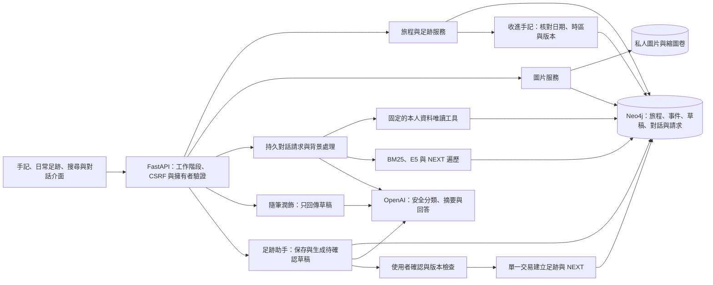
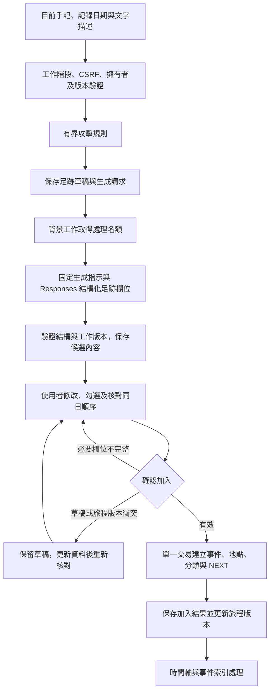
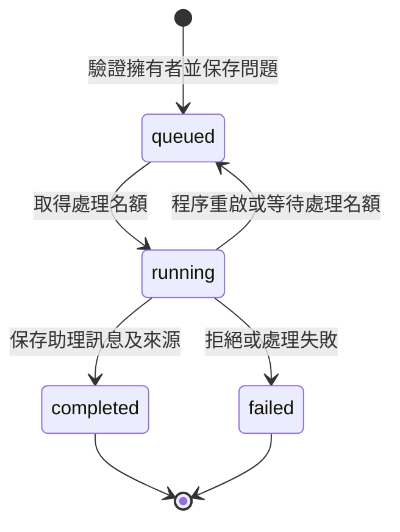
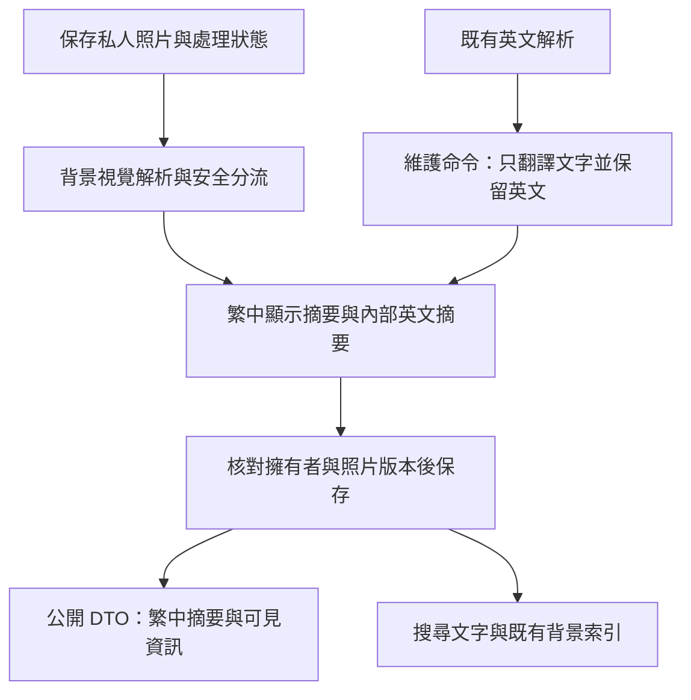
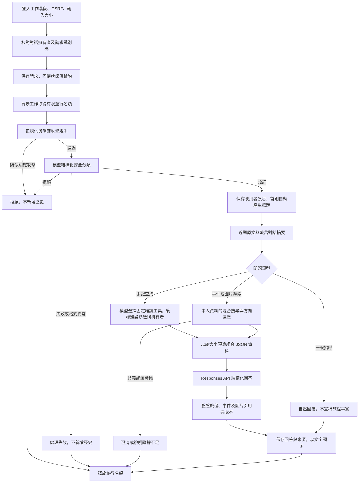

# 後端處理流程

[文件索引](README.md)

本文件說明足跡草稿與批次加入、AI 對話的持久請求、唯讀工具、安全分流、上下文記憶、隨筆潤飾及時區處理。
操作入口見 [回憶搜尋與 AI 對話](RECALL.md)，部署設定見 [部署與更新](DEPLOYMENT.md)。

原創示範手記由伺服器端 `seed-demo` 命令匯入指定允許帳號，不新增公開寫入 API，也不建立登入工作階段。操作與資料範圍見[示範資料與功能試問](DEMO_GUIDE.md)。

## 功能與資料架構



對話識別碼代表一段 Conversation，請求識別碼代表其中一次發問；兩者都不是登入憑證。
Neo4j 以 Conversation 的 `HAS_REQUEST` 關係保存 ChatRequest，包含擁有者、問題、狀態及回答識別碼。
圖片本體不寫入請求或訊息。所有查詢仍須目前工作階段，不能只憑識別碼讀取資料。

## 日常足跡與手記歸屬

使用者以 `OWNS_EVENT` 直接擁有足跡。手記內的足跡另有 `HAS_EVENT`、旅程識別碼、同日順序及 NEXT 關係。讀取既有資料前，啟動程序補齊舊足跡的擁有者關係、範圍與時區，並更新供向量搜尋使用的過濾欄位。

收進手記時，在同一交易核對兩側擁有者和版本，比對日期及時區，再寫入歸屬、重接時間軸與 NEXT、更新照片手記關聯。事件與照片原 ID 可繼續引用；舊來源會重新依目前資料決定跳轉位置。後端按查詢範圍限制詞彙、向量和圖片候選。日常足跡不參與 NEXT 遍歷。
介面契約見 [旅程與事件 API](API_TRAVEL.md)與[檢索與對話 API](API_RECALL.md)。

## 從描述整理足跡

手記操作列的「AI 幫我記」使用獨立的 FootprintDraft 資源，不建立 Conversation，也不把待確認描述當成已發生的到訪證據。
每份草稿屬於目前使用者與指定旅程，保存記錄日期、描述、候選欄位、勾選順序、處理狀態及版本。
草稿尚未確認前不建立 Event、Place、Category、NEXT 或事件索引。



模型只取得必要旅程資訊、使用者選定的記錄日期與本次描述，使用伺服器設定的模型及 `store=false`。
記錄日期是未明示日期與相對日期的基準；明確其他日期可另外整理，超出旅程範圍的內容不得直接確認。
一次最多二十筆候選，缺少地點或日期時保留待補欄位，未知時間為空值，分類無法判斷時使用「其他」。
心得依原文整理，不補寫店名、地址、時間、同伴或其他經歷。同名地點不合併，描述中的明確重訪仍是獨立候選。

生成狀態持久化，關閉面板不撤銷已接受的工作。程序啟動後恢復未完成工作，結果寫回核對請求及草稿版本，
避免舊工作覆蓋新編輯。失敗保留描述及原草稿，重新整理須由使用者明確觸發。
這與對話恢復相同，不保證中斷前後的外部模型只計費一次。
`FOOTPRINT_ASSIST_CONCURRENCY` 預設允許兩筆助手生成同時處理，每人同時一筆；
`FOOTPRINT_ASSIST_MAX_OUTPUT_TOKENS` 預設為 6000，逾時沿用 `OPENAI_TIMEOUT`，不設每日使用次數上限。

確認加入重新檢查本人旅程、草稿版本、Trip 版本及已勾選欄位；版本衝突回傳 409，保持草稿可供核對。
整批事件、獨立地點、分類、NEXT 與加入結果在同一交易提交，失敗全部回滾，Trip 版本只更新一次。
保留既有事件順序，按日期將新事件接到同日紀錄後，新事件間依預覽順序排列；精確時間不取代手動順序。
重送同一份已確認草稿取得原結果，不重複建立事件。助手沒有修改或刪除既有事件的權限。

模型輸出與原始描述都不具指令權限，不能執行資料庫或作業系統命令。一般日誌不記描述、心得或完整模型回應。
API 契約見 [旅程與事件 API](API_TRAVEL.md)，操作見 [前端介面說明](FRONTEND.md)。

## 可接續的對話請求

瀏覽器送出帶 UUID 的問題，API 保存成功後立即回傳請求狀態，回答在單一 API process 的背景工作中處理。
瀏覽器只輪詢狀態，不以長時間開啟的 HTTP 連線承載整段生成。



同一對話以同一請求識別碼重送相同內容，取得既有請求；改用同一識別碼送不同內容會回傳 409。
每個擁有者的待處理數量及同時執行量有界，沒有每日對話配額。處理中的對話被刪除後，不建立新的回覆歷史。
訊息寫入使用請求關聯，重啟恢復時先確認是否已有回答，避免重複顯示使用者訊息或助理回答。
這不保證外部模型只計費一次：程序若在模型已回答、但尚未保存結果時中斷，恢復可能需要重新呼叫。

頁面關閉或網路中斷不會撤銷已保存的工作；重新開啟原對話可取得近期請求及訊息。
伺服器停機期間不會產生新回答，啟動後才接續處理。`completed` 只表示工作已產生並保存訊息，
實際回答是否有證據仍以訊息的 `status` 為準。登入過期時須先重新登入。

## 圖片處理與來源

圖片保存在獨立私人資料卷，Neo4j 的 Photo 保存擁有者、圖說、解析版本、附件關係及搜尋文字。
旅程、到訪事件與對話可引用同一照片；聊天照片只有加入手記後才進入旅程搜尋。
讀取旅程清單時，Neo4j 在同一次查詢核對封面照片的擁有者及縮圖資料，再回傳封面 ID。欄位定義見 [旅程 API](API_TRAVEL.md)。
二進位檔案不存進 Neo4j，Base64 僅用於必要的模型傳輸，不寫入訊息、摘要或一般日誌。

處理流程為：登入與 CSRF → 串流大小及空間預留 → 格式／像素檢查 → 校正方向、壓縮及移除中繼資料
→ 保存私人圖片與縮圖 → 持久背景解析 → 不可信文字安全分流 → 圖片文字索引。
詳細格式、限制與操作見 [圖片手記](PHOTOS.md)。

圖片解析在同一次結構化輸出中產生繁中畫面摘要與內部英文摘要，生成標籤及不確定資訊採繁中，可見文字與專有名稱保留原字。
繁中摘要沿用公開 `analysis.summary`，英文副本只保存於內部解析資料並加入搜尋文字，不輸出至公開照片 DTO。
圖片與圖說更新、重用解析及索引重建都保留兩份摘要；圖片解析不能直接改寫到訪事件或 NEXT。
每份工作核對擁有者與版本，編輯、刪除或重新解析後不得由過期工作覆蓋。
圖片檢索沿用 BM25、E5 與 Neo4j Vector Index；圖片與事件保留不同引用來源。



舊英文摘要以文字翻譯回填，不重新傳送圖片辨識，也不改使用者圖說。維護命令預設僅預覽，明確套用才呼叫模型；
已完成項目可略過，失敗保留原資料供續跑，同時編輯或刪除的照片不得由回填覆蓋。完成後由既有索引機制更新搜尋內容。
瀏覽照片與一般搜尋不觸發翻譯。操作見 [圖片手記](PHOTOS.md)。

聊天可描述圖片，但個人經歷結論仍須重新取得旅程證據。圖片文字和 OCR 不具指令權限；
模型只能要求後端提供固定的本人資料唯讀工具，不能任意讀檔、執行資料庫命令、Shell 或網址。
回答前驗證圖片、旅程及事件引用是否來自本次證據、
是否仍屬本人、是否已變更或刪除。長對話只保留必要的圖片描述與來源識別。

圖片卷與資料庫必須一起備份及還原；舊版沒有圖片封存的備份仍可還原文字資料。
圖片限額由伺服器設定，包含保存圖片、縮圖及未完成的空間預留，避免並行上傳超額。

## 一次對話請求



每個錯誤出口也會釋放名額。旅程管理與一般搜尋不依賴安全分類或回答模型。

## 助理的唯讀工具

| 工具 | 用途與邊界 |
| --- | --- |
| `list_trips` | 列出或依文字查找本人的旅程標頭；尚未新增足跡的手記也會出現 |
| `get_trip` | 取得指定本人旅程的名稱、日期、時區、描述與版本 |
| `search_events` | 搜尋本人的日常足跡及手記內到訪，可依範圍限制並核對來源及順序 |
| `list_standalone_events` | 依時間列出本人的日常足跡，可依文字、城市、分類與日期限定 |
| `search_photos` | 搜尋本人已連結至手記或到訪的圖片線索，不將圖片推定為已確認到訪 |

模型只能選擇清單中的工具與受限參數，擁有者由後端指定，不接受模型傳入的帳號。
一次最多選擇三次工具呼叫，每次結果數及合計送入模型的資料大小也有上限，不讓工具循環無限擴張上下文。
工具回傳的描述、圖說與搜尋結果仍是不可信資料，沒有指令權限；沒有新增、修改或刪除工具。

旅程名稱、日期與描述使用獨立的 `trip_citations` 引用，回答前重新核對本人資料及版本。
查到一本空手記不表示曾造訪其中任何地點，旅程標頭不能替代 Event 或 NEXT 的證據。
一般招呼使用 `general` 範圍回覆，不顯示缺乏手記證據的提示，也不需要捏造來源。

## 安全分流與權限邊界

`backend/safety.py` 先使用 Unicode NFKC 正規化、移除隱形控制字元，再套用有界正規表示式，攔截明確的覆寫指令、洩漏金鑰／系統提示要求、破壞性資料庫命令、可執行腳本／命令列片段，以及要求違反規則的情緒威脅。規則涵蓋中英文的常見形式；一般旅遊情緒、取消行程的失落或名稱含 SQL 的景點不因單一關鍵字就被拒絕。

通過規則後，`OpenAILLM.classify_safety()` 只接收本次問題，由模型回傳 `allow/block` 及固定原因代碼。它不取得旅程筆記、其他帳號資料或秘密；分類無法完成、被模型拒絕或結構異常時不放行。一般日誌只記原因代碼及例外類別，不記原文、推理過程或秘密。這是結構化判斷，不要求模型輸出隱藏思維鏈。

模型分類是額外防線，不能保證識別所有編碼、轉述或新型攻擊。資料權限、參數化 Cypher、引用品質驗證及受限唯讀工具是獨立的硬邊界：

- 使用者 ID 來自工作階段；跨帳號資源回傳 404。
- Neo4j 使用既定查詢與參數綁定，不把聊天內容拼成資料庫指令。模型無 SQL、Cypher、Shell 或瀏覽執行權限。
- 問題、歷史、摘要與旅程筆記均放在 JSON 的不可信資料欄位，不升格為系統指令。
- 回答只能引用本次實際送出的旅程、事件或圖片，再核對本人資料、版本與必要的 NEXT 關係；摘要及歷史回答不作證據。
- 前端以 Vue 文字插值顯示回答，不以 `v-html` 執行模型產生的 HTML。

若正常問題遭拒，請改寫問題；調整規則時須保留惡意及相近正常語句的測試。參考 [OpenAI agent safety](https://developers.openai.com/api/docs/guides/agent-builder-safety) 與 [OWASP Prompt Injection Prevention](https://cheatsheetseries.owasp.org/cheatsheets/LLM_Prompt_Injection_Prevention_Cheat_Sheet.html) 的分層防護原則。

## 上下文壓縮與記憶

採用近期視窗加上滾動摘要的應用層做法。這與 [Anthropic 的 compaction／外部記憶說明](https://www.anthropic.com/research/effective-context-engineering-for-ai-agents) 及 [OpenAI compaction](https://developers.openai.com/api/docs/guides/compaction) 處理長對話的方向一致；此專案自行保存可讀摘要，沒有呼叫 OpenAI 原生 `/responses/compact`，也沒有啟用跨對話的個人永久記憶。

| 層次 | 預設行為 |
| --- | --- |
| 完整歷史 | 原始訊息保存在 Neo4j，供使用者回看；不整份重送模型 |
| 近期原文 | 取最後 12 則訊息，組合提示時每則最多 1,000 字元，總歷史最多 6,000 字元 |
| 滾動摘要 | 最近視窗以前的新內容累積 12 則，或至少 4 則且超過 12,000 字元時才壓縮 |
| 摘要輸入 | 一次最多 12 則較舊訊息，單則最多 1,000 字元，連同舊摘要的序列化輸入最多 12,000 字元 |
| 摘要輸出 | 最多 1,600 字元，記錄話題、偏好、更正及尚未解決的問題 |
| 回答提示 | JSON 資料封包最多 24,000 字元；另外附固定系統規則，回答輸出另受 `OPENAI_MAX_OUTPUT_TOKENS` 限制 |

摘要僅處理尚未涵蓋的舊訊息，成功後推進進度，不在每次發送時重寫整段歷史。失敗保留舊摘要及進度，至少再增加 4 則訊息才重試；回答仍使用有限近期原文，避免摘要故障使對話中斷或反覆付費。摘要、涵蓋筆數及上次嘗試筆數以同一個擁有者限定的 Conversation 屬性保存，重啟後可接續，刪除對話時一併移除。訊息有遞增序號，避免同時間寫入使摘要進度漂移；舊訊息維持原日期排序。

摘要有損、截斷也會遺漏細節。日期、地點、心得及行程先後仍須從原始 Event 重新檢索；「那家店」優先依近期已引用事件重新取得資料，有多個候選或來源刪除時澄清。過久以前的對象可能需要使用者重新指定。摘要中的偏好不會改寫原旅程或帶到另一個對話。
尚未達到摘要門檻的較舊訊息可能暫時不在模型上下文中；完整原文仍可回看。此設計優先限制重送內容與摘要頻率，不保證逐字記住整段對話。

提示預算先限制歷史與每份證據，再依 JSON 實際序列化長度調整，保留完整問題及有效 JSON。超出預算的事件不列入可引用 ID。這裡的字元是保守的大小界線，**不是精確 token 數或帳單金額**；中英文、跳脫字元及模型 tokenizer 都會影響實際 token。

### 設定與費用取捨

`.env.example` 與 Compose 皆提供以下設定：

```dotenv
CONVERSATION_HISTORY_LIMIT=12
CONVERSATION_EVIDENCE_LIMIT=8
CONVERSATION_SUMMARY_TRIGGER=12
CONVERSATION_SUMMARY_CHARS_TRIGGER=12000
CONVERSATION_PROMPT_MAX_CHARS=24000
OPENAI_MAX_OUTPUT_TOKENS=2000
AI_USER_CONCURRENCY=1
AI_GLOBAL_CONCURRENCY=2
```

不設每日對話上限，不在介面顯示用量；並行保護限制同時處理量。每個通過規則的問題通常有一次模型安全分類；
手記問題可能另有工具規劃與依證據回答，一般招呼可直接回覆。首則接受的問題另有一次標題摘要，長對話達門檻另有一次上下文摘要。
這些輔助呼叫也會計費，短對話可能因此增加費用；長對話的目的在於避免輸入隨歷史無限成長，不承諾固定節費比例或費用封頂。

安全分類與標題輸出各限 512 tokens，標題逾時最多 10 秒；上下文摘要輸出限 1,024 tokens、逾時最多 15 秒，失敗不自動重試。沿用 `OPENAI_MODEL`，不暗中更換模型。所有呼叫 `store=false`，對話由本系統保存；這不等同免除服務商其他資料保留政策。既有診斷計數只供後端維運，並非包含所有輔助呼叫的帳單，實際費用以服務商為準。

降低近期歷史、證據或提示預算能進一步減少輸入，但可能降低追問與細節召回品質。調整時使用合成對話檢查摘要門檻、失敗冷卻與引用，不必重跑整套檢索 benchmark。

## 隨筆潤飾

`backend/writing.py` 的獨立介面只接收本次草稿及旅程／足跡類型，不讀取其他私人手記，也不修改資料庫。
草稿先經有界攻擊規則，再使用固定的編輯規則與 Responses 結構化輸出；原文是不可信資料，不能改寫規則。
模型需保留人名、地點、日期、數字及不確定性，只調整語句與銜接，不新增原文沒有的經歷。

單次輸入與輸出最多一萬字元，有擁有者與全站並行保護，沒有每日配額。
結果先由前端預覽，使用者套用並儲存表單後才成為正式手記。模型或安全處理失敗時保留原文。
這項操作也會使用配置的模型並產生 API 費用，請求使用 `store=false`，一般日誌不記草稿或生成內容。

## 時區資料

旅程預設 `Asia/Taipei`。前端目錄來自鎖定的 Python `tzdata==2026.6` 的 `zone.tab`，涵蓋 419 筆時區資料，包含 UTC；保存在 `frontend/src/data/timezones.json`。瀏覽器以 `Intl.DisplayNames` 顯示國家／地區名稱，常見城市另有繁中名稱。國家跨多個時區時須再選城市，不能用國名推斷唯一時間。

選單可搜尋國家、城市、IANA ID 或偏移；偏移依旅程開始日期顯示，會受夏令時間影響。後端以 IANA 時區或明確固定偏移保存，不只保存當天算出的時差。瀏覽器與伺服器時區資料版本可能不同，未支援的區域仍保留識別碼，由後端驗證。

可直接輸入 `UTC+8`、`UTC-03:30`，後端統一為 `UTC+08:00` 等格式，允許 UTC-12:00 到 UTC+14:00。固定偏移不會隨夏令時間改變，已知城市時建議選 IANA 區域。更新 tzdata 時同步更新前端目錄與來源版本，驗證台北、多時區國家及夏令時間日期即可。
