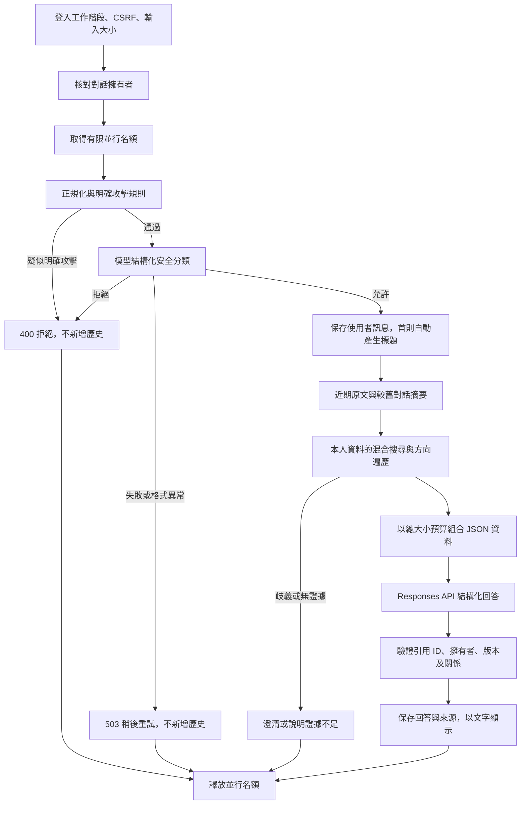

# 後端處理流程

本文件說明 AI 對話的安全分流、上下文記憶及時區處理。操作入口見 [回憶搜尋與 AI 對話](RECALL.md)，部署設定見 [部署與更新](DEPLOYMENT.md)。

## 一次對話請求



每個錯誤出口也會釋放名額。旅程管理與一般搜尋不依賴安全分類或回答模型。

## 安全分流與權限邊界

`backend/safety.py` 先使用 Unicode NFKC 正規化、移除隱形控制字元，再套用有界正規表示式，攔截明確的覆寫指令、洩漏金鑰／系統提示要求、破壞性資料庫命令、可執行腳本／命令列片段，以及要求違反規則的情緒威脅。規則涵蓋中英文的常見形式；一般旅遊情緒、取消行程的失落或名稱含 SQL 的景點不因單一關鍵字就被拒絕。

通過規則後，`OpenAILLM.classify_safety()` 只接收本次問題，由模型回傳 `allow/block` 及固定原因代碼。它不取得旅程筆記、其他帳號資料或秘密；分類無法完成、被模型拒絕或結構異常時不放行。一般日誌只記原因代碼及例外類別，不記原文、推理過程或秘密。這是結構化判斷，不要求模型輸出隱藏思維鏈。

模型分類是額外防線，不能保證識別所有編碼、轉述或新型攻擊。資料權限、參數化 Cypher、引用品質驗證及無執行工具才是獨立的硬邊界：

- 使用者 ID 來自工作階段；跨帳號資源回傳 404。
- Neo4j 使用既定查詢與參數綁定，不把聊天內容拼成資料庫指令。模型無 SQL、Cypher、Shell 或瀏覽執行權限。
- 問題、歷史、摘要與旅程筆記均放在 JSON 的不可信資料欄位，不升格為系統指令。
- 回答只能引用本次實際送出的事件，再核對本人資料、版本與 NEXT 關係；摘要及歷史回答不作證據。
- 前端以 Vue 文字插值顯示回答，不以 `v-html` 執行模型產生的 HTML。

若正常問題遭拒，請改寫問題；調整規則時須保留惡意及相近正常語句的測試。參考 [OpenAI agent safety](https://developers.openai.com/api/docs/guides/agent-builder-safety) 與 [OWASP Prompt Injection Prevention](https://cheatsheetseries.owasp.org/cheatsheets/LLM_Prompt_Injection_Prevention_Cheat_Sheet.html) 的分層防護原則。

## 上下文壓縮與記憶

採用近期視窗加上滾動摘要的應用層做法。這與 [Anthropic 的 compaction／外部記憶說明](https://www.anthropic.com/research/effective-context-engineering-for-ai-agents) 及 [OpenAI compaction](https://developers.openai.com/api/docs/guides/compaction) 處理長對話的方向一致；此專案自行保存可讀摘要，沒有呼叫 OpenAI 原生 `/responses/compact`，也沒有啟用跨對話的個人永久記憶。

| 層次 | 預設行為 |
| --- | --- |
| 完整歷史 | 原始訊息保存在 Neo4j，供使用者回看；不整份重送模型 |
| 近期原文 | 取最後 12 則訊息，組合提示時每則最多 1,000 字元，總歷史最多 6,000 字元 |
| 滾動摘要 | 最近視窗以前的新內容累積 12 則，或至少 4 則且超過 12,000 字元時才壓縮 |
| 摘要輸入 | 一次最多 12 則較舊訊息，單則最多 1,000 字元，連同舊摘要的序列化輸入最多 12,000 字元 |
| 摘要輸出 | 最多 1,600 字元，記錄話題、偏好、更正及尚未解決的問題 |
| 回答提示 | JSON 資料封包最多 24,000 字元；另外附固定系統規則，回答輸出另受 `OPENAI_MAX_OUTPUT_TOKENS` 限制 |

摘要僅處理尚未涵蓋的舊訊息，成功後推進進度，不在每次發送時重寫整段歷史。失敗保留舊摘要及進度，至少再增加 4 則訊息才重試；回答仍使用有限近期原文，避免摘要故障使對話中斷或反覆付費。摘要、涵蓋筆數及上次嘗試筆數以同一個擁有者限定的 Conversation 屬性保存，重啟後可接續，刪除對話時一併移除。訊息有遞增序號，避免同時間寫入使摘要進度漂移；舊訊息維持原日期排序。

摘要有損、截斷也會遺漏細節。日期、地點、心得及行程先後仍須從原始 Event 重新檢索；「那家店」優先依近期已引用事件重新取得資料，有多個候選或來源刪除時澄清。過久以前的對象可能需要使用者重新指定。摘要中的偏好不會改寫原旅程或帶到另一個對話。
尚未達到摘要門檻的較舊訊息可能暫時不在模型上下文中；完整原文仍可回看。此設計優先限制重送內容與摘要頻率，不保證逐字記住整段對話。

提示預算先限制歷史與每份證據，再依 JSON 實際序列化長度調整，保留完整問題及有效 JSON。超出預算的事件不列入可引用 ID。這裡的字元是保守的大小界線，**不是精確 token 數或帳單金額**；中英文、跳脫字元及模型 tokenizer 都會影響實際 token。

### 設定與費用取捨

`.env.example` 與 Compose 皆提供以下設定：

```dotenv
CONVERSATION_HISTORY_LIMIT=12
CONVERSATION_EVIDENCE_LIMIT=8
CONVERSATION_SUMMARY_TRIGGER=12
CONVERSATION_SUMMARY_CHARS_TRIGGER=12000
CONVERSATION_PROMPT_MAX_CHARS=24000
OPENAI_MAX_OUTPUT_TOKENS=2000
AI_USER_CONCURRENCY=1
AI_GLOBAL_CONCURRENCY=2
```

不設每日對話上限，不在介面顯示用量；並行保護限制同時處理量。每個通過規則的問題通常有一次模型安全分類；有證據才呼叫回答模型。首則接受的問題另有一次標題摘要，長對話達門檻另有一次上下文摘要。這些輔助呼叫也會計費，短對話可能因此增加費用；長對話的目的在於避免輸入隨歷史無限成長，不承諾固定節費比例或費用封頂。

安全分類與標題輸出各限 512 tokens，標題逾時最多 10 秒；上下文摘要輸出限 1,024 tokens、逾時最多 15 秒，失敗不自動重試。沿用 `OPENAI_MODEL`，不暗中更換模型。所有呼叫 `store=false`，對話由本系統保存；這不等同免除服務商其他資料保留政策。既有診斷計數只供後端維運，並非包含所有輔助呼叫的帳單，實際費用以服務商為準。

降低近期歷史、證據或提示預算能進一步減少輸入，但可能降低追問與細節召回品質。調整時使用合成對話檢查摘要門檻、失敗冷卻與引用，不必重跑整套檢索 benchmark。

## 時區資料

旅程預設 `Asia/Taipei`。前端目錄來自鎖定的 Python `tzdata==2026.6` 的 `zone.tab`，涵蓋 419 筆時區資料，包含 UTC；保存在 `frontend/src/data/timezones.json`。瀏覽器以 `Intl.DisplayNames` 顯示國家／地區名稱，常見城市另有繁中名稱。國家跨多個時區時須再選城市，不能用國名推斷唯一時間。

選單可搜尋國家、城市、IANA ID 或偏移；偏移依旅程開始日期顯示，會受夏令時間影響。後端以 IANA 時區或明確固定偏移保存，不只保存當天算出的時差。瀏覽器與伺服器時區資料版本可能不同，未支援的區域仍保留識別碼，由後端驗證。

可直接輸入 `UTC+8`、`UTC-03:30`，後端統一為 `UTC+08:00` 等格式，允許 UTC-12:00 到 UTC+14:00。固定偏移不會隨夏令時間改變，已知城市時建議選 IANA 區域。更新 tzdata 時同步更新前端目錄與來源版本，驗證台北、多時區國家及夏令時間日期即可。
